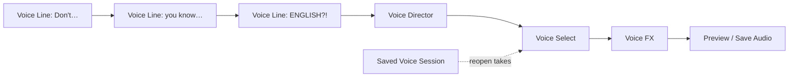

# vallpaper.store · Voice

**Direct the dialogue. Choose the take. Shape the sound.**

A ComfyUI node pack for phrase-by-phrase voice direction, alternate takes and
room, robot and bass effects. Speech runs in a separate IndexTTS 2.5 environment;
audio effects run on the CPU. No cloud API or microphone recording is required.

**v0.1.0 · Windows-first · Early release**

> The Director and FX helpers pass 17 CPU tests. The newly added Director/FX
> workflow has not been executed in ComfyUI or tested end to end on a GPU.
> The earlier single-voice runtime generated audio locally, but that is not an
> integration test of this release. No performance benchmark is claimed.

## What is included

| Node | What it does |
| --- | --- |
| **Voice** | Generate a single passage with emotion descriptions or eight emotion sliders. Optional AUDIO reference overrides the built-in voice. |
| **Voice Line** | Set one phrase's dialogue, delivery, voice, language, emotion strength, duration, pitch, gain and following pause. Chain lines together. |
| **Voice Director** | Generate numbered alternate takes for each phrase. Load speech models once per session and release their GPU memory when the worker exits. |
| **Voice Select** | Choose takes with `1,2,1`, join them with their pauses, and save a timeline. No inference. |
| **Voice Session** | Reopen a completed session after restarting ComfyUI, without regenerating speech. |
| **Voice FX** | Apply room/hall/outdoor effects, metallic robot modulation, bass, combined robot + bass, or custom settings to any AUDIO input. |

All nodes appear under **vallpaper.store/audio**. Display names start with
`vallpaper.store ·`.



## Install the nodes

Clone into the `custom_nodes` folder of your ComfyUI installation:

```powershell
cd C:\ComfyUI\custom_nodes
git clone https://github.com/dharaniVibeDev/ComfyUI-vallpaper-voice.git vallpaper-voice
```

Install the small node-side dependencies with **ComfyUI's Python** if missing:

```powershell
C:\ComfyUI\.venv\Scripts\python.exe -m pip install -r C:\ComfyUI\custom_nodes\vallpaper-voice\requirements.txt
```

Restart ComfyUI and refresh the browser when you are ready. Installing these
files does not start a server, download a model, or generate audio.

**Voice FX works independently of IndexTTS.** To use speech generation, prepare
the separate runtime below. Do not install IndexTTS's Transformers requirements
into your working ComfyUI environment.

## Prepare the isolated speech runtime

The expected layout is:

```text
%USERPROFILE%/Apps/VallpaperTTS/
├── .venv/Scripts/python.exe
├── indextts/                         # T8's vendored IndexTTS 2.5 core
├── models/IndexTTS-2.5/               # complete model bundle + auxiliary models
└── voices/
    ├── Windows-neutral.wav
    └── Windows-Zira.wav
```

An existing runtime with this layout can be reused. Set `VALLPAPER_TTS_HOME`
before launching ComfyUI if you use a different location. Both voice workers
use that setting. The paths are resolved from your user account, not the
developer's Windows username.

For a new **Windows ComfyUI venv installation**, these PowerShell commands create
the separate environment while reusing ComfyUI's existing PyTorch files. Change
`$comfyPython` to your installation's interpreter. This setup path is not an
installer for portable/embedded Python or other operating systems.

```powershell
$comfyPython = 'C:\ComfyUI\.venv\Scripts\python.exe'
$runtime = Join-Path $env:USERPROFILE 'Apps\VallpaperTTS'
git clone https://github.com/T8mars/comfyui-indextts25-t8.git $runtime
git -C $runtime checkout 22c65286ccaf87665b6b3a65107beb84e45267b3
& $comfyPython -m venv (Join-Path $runtime '.venv')
$ttsPython = Join-Path $runtime '.venv\Scripts\python.exe'
$sharedPackages = & $comfyPython -c 'import site; print(site.getsitepackages()[0])'
Set-Content (Join-Path $runtime '.venv\Lib\site-packages\comfy_shared.pth') $sharedPackages
& $ttsPython -m pip install -r (Join-Path $runtime 'requirements.txt')
& $ttsPython -m pip install -r (Join-Path $runtime 'requirements-text-normalization.txt')
```

The new environment supplies its own Transformers 4.x and dependencies. It
reads ComfyUI's PyTorch installation, which must remain available. The local
development environment used Python 3.13, PyTorch CUDA 13.0 and Transformers
4.57.6 in the isolated runtime; other combinations need validation.

Models are separate downloads, approximately **8.29 GB** for the complete
26-file bundle used during development. After reviewing the upstream model
license and disclaimer, use its downloader from the isolated environment:

```powershell
& $ttsPython (Join-Path $runtime 'scripts\download_models.py') `
  --target (Join-Path $runtime 'models\IndexTTS-2.5') `
  --source huggingface --accept-license
```

Do not use `--skip-aux`: the reference encoders and vocoder are required.
The workers use offline model loading and do not fetch missing files during
generation. Model download and license acceptance are explicit setup steps.

Create starter references from installed English Windows voices:

```powershell
& C:\ComfyUI\custom_nodes\vallpaper-voice\scripts\create_windows_voices.ps1 -Runtime $runtime
```

This uses Windows speech synthesis, not a microphone. David and Zira must be
installed for their corresponding files. Alternatively, place your own clean
reference WAVs at the two documented filenames. Windows reference voices are
starter material; their character and quality affect the output.

## Try the villain example

Open [Voice Director - Villain + FX.json](examples/Voice%20Director%20-%20Villain%20%2B%20FX.json)
in ComfyUI. It contains:

| Phrase | Delivery | Duration factor | Pitch | Pause |
| --- | --- | --- | --- | --- |
| `Don't…` | Quiet, cold menace | 1.5 | −3 semitones | 450 ms |
| `you know…` | Growing, restrained anger | 1.3 | 0 | 350 ms |
| `ENGLISH?!` | Forceful, accusatory finish | 1.1 | +2 semitones | 0 |

1. Edit the Voice Line text and delivery prompts.
2. Set **takes_per_line** on Voice Director. Start with one or two.
3. Keep the seed's after-generation control on **fixed** and queue the workflow.
4. Listen to the selected assembly. Set Voice Select to `1,2,1` to use the
   second take of the middle phrase, then queue again.
5. Change Voice FX to compare sound treatments without regenerating the voice.
6. Add a Save Audio node after FX to save the processed result permanently.

ComfyUI can reuse the Director's cached output while only Select/FX changes.
Changing a Voice Line or Director input regenerates the session. After a server
restart, connect **Voice Session → Voice Select** to reopen existing takes.
Refresh the browser to update the saved-session dropdown.

Alternate takes use sampling and distinct saved seeds. A different seed does
not guarantee a perceptibly different take, and software changes can affect
reproducibility.

## Direction controls

| Control | Meaning |
| --- | --- |
| `delivery` | Natural-language emotional intent, interpreted by the emotion helper. It is not a general acting-command engine. |
| `emotion_strength` | Strength of emotion guidance, from 0 to 1. |
| `duration_factor` | Larger values produce slower/longer speech; 0.5–2.0. |
| `pitch_semitones` | Constant pitch shift applied after synthesis to that phrase. |
| `gain_db` | Post-generation gain for the phrase. |
| `pause_after_ms` | Silence after the phrase, including after the final phrase if set. |

Pitch changes are per phrase, not an exact continuous pitch curve within a word.
Speech direction is probabilistic. The model cannot promise a perfect human
performance, precise emphasis or a particular actor's voice.

## Voice FX presets and custom panel

**Dry · Small room · Large room · Hall · Outside · Robot · Bass · Robot + bass ·
Metallic / clang · Custom**

- **reverb_amount** scales a preset's wet mix. Set 0 to remove its room reverb.
- **bass_adjust_db** adds bass boost or cut to any preset.
- Enable **custom_controls**, or choose **Custom**, to replace preset parameters
  with the custom knobs below it.

| Custom control | What it changes |
| --- | --- |
| `wet` | Reverb dry/wet balance |
| `decay` | Approximate reverb decay in seconds |
| `predelay_ms` | Delay before the reverb begins |
| `damping_hz` | High-frequency damping in the reverb tail |
| `room_size` | Spacing of reflections |
| `robot_mix`, `robot_hz` | Ring-modulation amount and carrier frequency |
| `bass_db` | Low-shelf gain around 180 Hz |
| `echo_ms`, `echo_mix` | One delayed reflection and its level |
| `normalize_peaks` | Scale down peaks above 0.98 to reduce clipping |

Outside uses a quiet reflection rather than a room tail. Robot is metallic
ring modulation, not a vocoder or a cloned robot character. Reverb uses an
algorithmic impulse, not a measured room recording. Long tails extend the audio.

**Acting happens before FX.** Use Voice Line to direct emotion and pacing; use
Voice FX to change the acoustics afterward. Its `effect_profile_json` output
records the applied settings, not instructions to the speech model.

## Output files

Director sessions are saved under ComfyUI's configured output directory:

```text
output/vallpaper_voice_director/<session>/
├── request.json
├── generation.log
├── progress.json
├── takes.json
├── line-001-take-01.wav
├── line-001-take-02.wav
├── joined.wav
├── selected-<id>.wav
└── selected-<id>.json
```

`takes.json` includes text, settings, seeds, file hashes, durations and clipped
sample counts. Selection JSON includes line start/end times and pauses.
Director/Select files contain audio **before Voice FX**. Save the FX output
with a downstream Save Audio node. Single Voice output uses `output/vallpaper_voice`.

## Hardware and troubleshooting

- **Windows-first, NVIDIA CUDA speech generation.** Other platforms are not
  validated. Voice FX itself uses CPU audio processing and no speech model.
- Speech workers use BF16 synthesis and CPU reference encoders. A preflight
  check requires at least **5.5 GB free VRAM**; this is not a peak-memory guarantee.
- Avoid concurrent speech and video generation on limited memory. When ComfyUI
  is idle, use its Free VRAM control if another workflow is holding models.
- Director loads models once per session and exits afterward. Interrupting a
  run terminates its worker. Finished takes remain, but incomplete sessions
  cannot be reopened by Voice Session.
- The speech workers share a runtime file lock. If another TTS run is active,
  wait for it to finish before retrying.
- Supported model languages: **English, Chinese, Japanese, Spanish and Arabic**.
  Tamil is not supported by this model.
- Workers request PCM results and save WAVs with SoundFile, avoiding a
  TorchCodec encoding dependency. Missing runtime files still cause explicit errors.
- Large phrase gain can distort speech before FX; inspect clipped sample counts
  and reduce `gain_db` rather than relying on later normalization.

## Development and validation

```powershell
python -m unittest discover -s tests -v
```

The 17 tests exercise CPU helpers with synthetic data: immutable script chains,
choices, seeds, WAV concatenation, exact pauses, file containment, dry audio,
reverb tails, outdoor delay, bass response and peak normalization. They do not
load models, import the ComfyUI node entry point, or start a server.

GPU inference and browser integration tests for Director/FX remain pending.
Please include node settings and the relevant generation log in bug reports,
after removing any private dialogue and file paths.

## Credits and license

Developed by [dharaniVibeDev](https://github.com/dharaniVibeDev) for vallpaper.store.

- [IndexTTS](https://github.com/index-tts/index-tts) provides the speech model.
- [T8's IndexTTS 2.5 integration](https://github.com/T8mars/comfyui-indextts25-t8)
  provides the vendored runtime used by these workers.
- [ComfyUI](https://github.com/Comfy-Org/ComfyUI) provides the host node system.

This repository's original code is [MIT licensed](LICENSE). Models, upstream
runtime code and Windows voice resources are not included and retain their
own licenses and terms. Their licenses are not replaced by this repository's MIT license.
